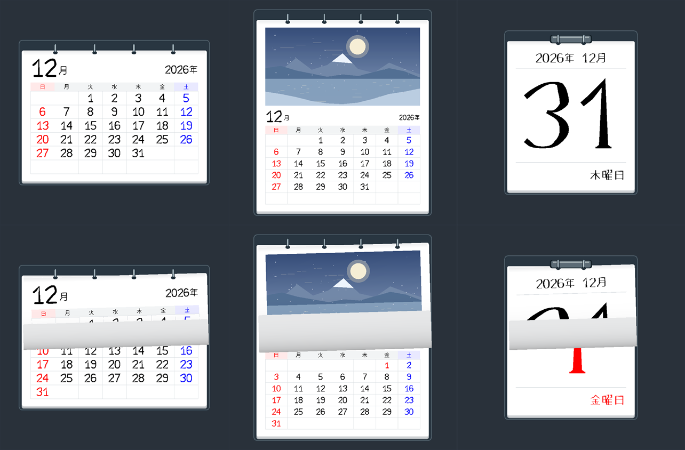

# カレンダー演出（SYNC_Calendar）

月めくりや日めくりのカレンダーを描き、紙をめくって時間の流れを表現する AviUtl ExEdit2 用オブジェクトプラグインです。静止表示、通常めくり、連続めくり、紙が戻る逆再生に対応します。

## インストール

AviUtl ExEdit2 2.1.16 以降で使用できます。

1. [v1.0.0 の SYNC_Calendar.zip](https://github.com/vramwiz/SYNC_Calendar/releases/download/v1.0.0/SYNC_Calendar.zip) をダウンロードして展開します。
2. 展開した `SYNC_Calendar` フォルダーを、AviUtl2 のプラグインフォルダー（通常は `C:\ProgramData\aviutl2\Plugin`）に入れます。
3. AviUtl2 を起動し、オブジェクト追加メニューの「SYNC」から「カレンダー演出」を追加します。

## カレンダーの種類

| 種類 | 表示内容 |
| --- | --- |
| 月めくり（全体表示型） | 日曜始まりの1か月を用紙全体に表示します。 |
| 月めくり（イラスト型） | 用紙の上部に季節の風景、下部に1か月分を表示します。 |
| 日めくり | 日付を大きく表示し、年月と曜日を添えます。字形は明朝、丸ゴシック、角ゴシック、手書き体から選べます。 |

## 日付とめくり

- 「基準年月日」と「目標年月日」は `YYYY/M/D` または `YYYY/MM/DD` で入力します。月めくりは年月単位で切り替わります。
- 静止表示は「演出」を「なし」にします。初期設定で「通常めくり」を選ぶと、2026年12月から2027年1月へめくります。
- 長い期間を短時間で進めるには「ペラペラめくり」を使います。過去へ戻る場合は目標を基準より前に設定し、「逆再生」または「ペラペラ逆再生」を選びます。
- 「時間設定」で開始までの時間と演出の長さを調整します。演出時間を0秒にすると開始時に切り替わります。

## 見た目と音

「祝日」には `1/1,2/11,2/23` のように月日を入力します。カンマや改行で区切れます。登録祝日が日曜に重なる場合は翌月曜も休日色になります。文字と用紙の色は「色設定」で変更できます。

位置・拡大率・回転・透明度には AviUtl2 の標準描画設定を使います。カメラ制御の対象にすると、紙の奥行きや曲がり方がカメラ描画に反映されます。紙をめくる音は「音量」で調整でき、0にすると消音になります。文字・イラスト・音はプラグイン内で生成します。

## ライセンス

本体は GPL-3.0-only です。SDK 由来の定義のライセンスは別記しています。[LICENSE](LICENSE) / [THIRD_PARTY_NOTICES.md](THIRD_PARTY_NOTICES.md)
